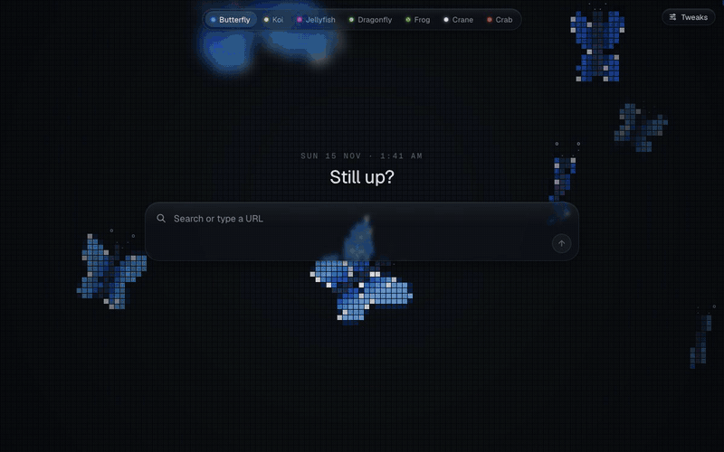
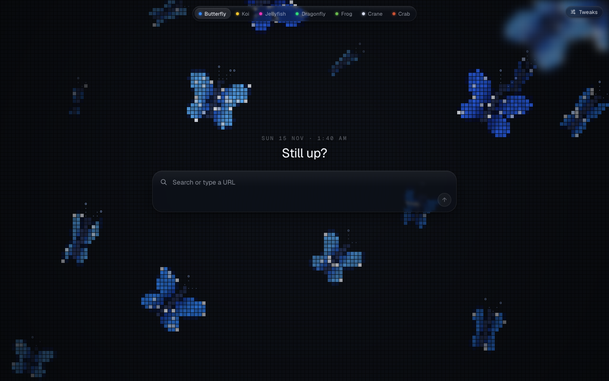
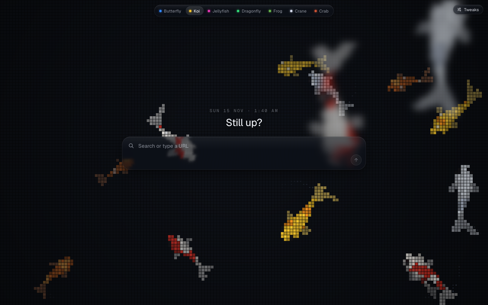
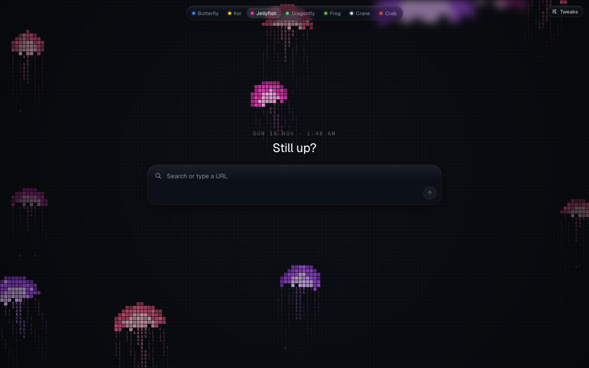
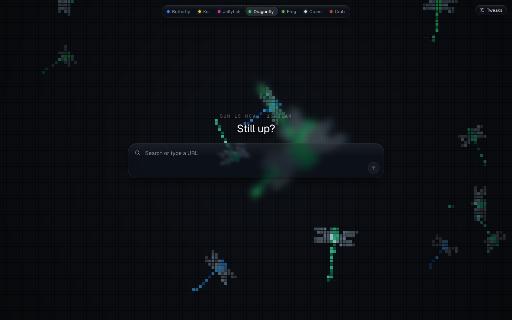
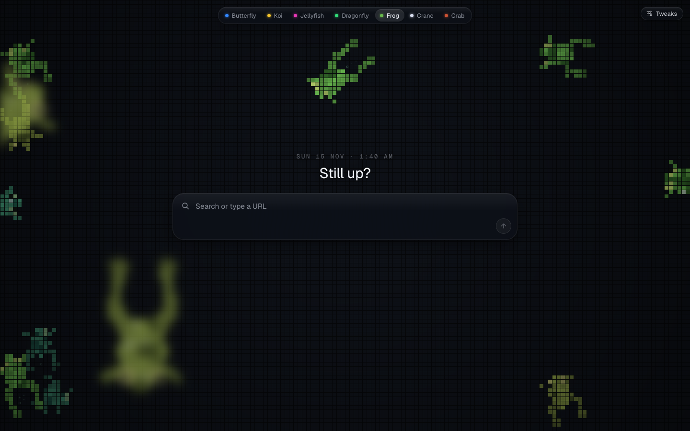
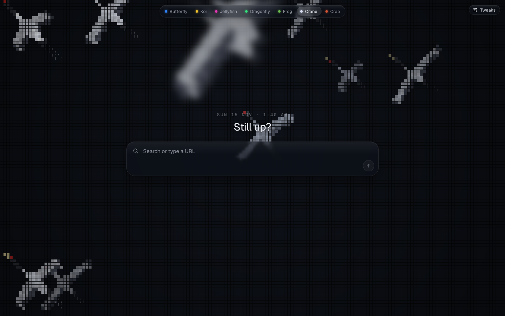
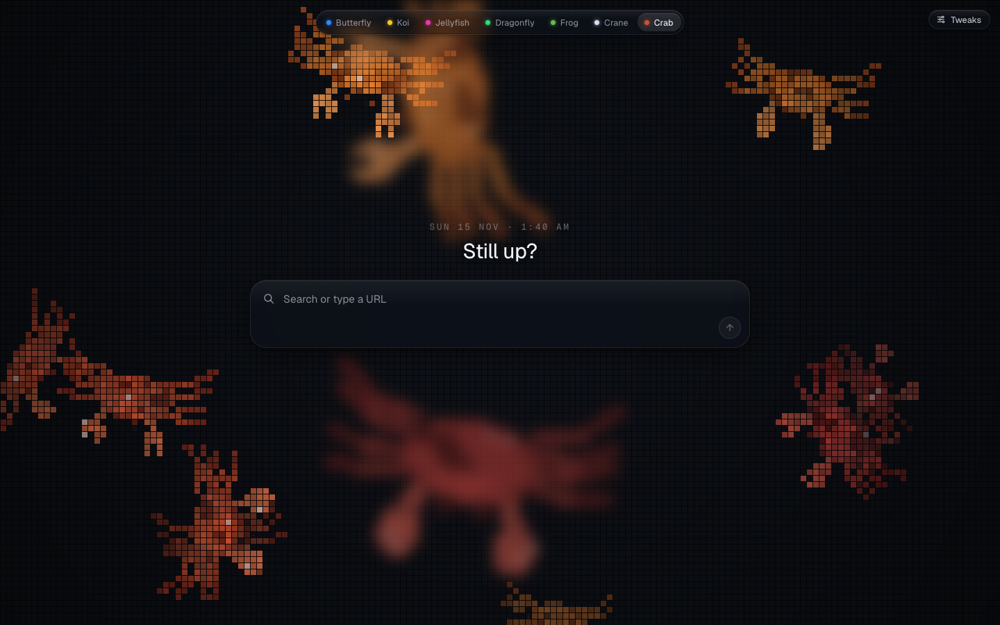
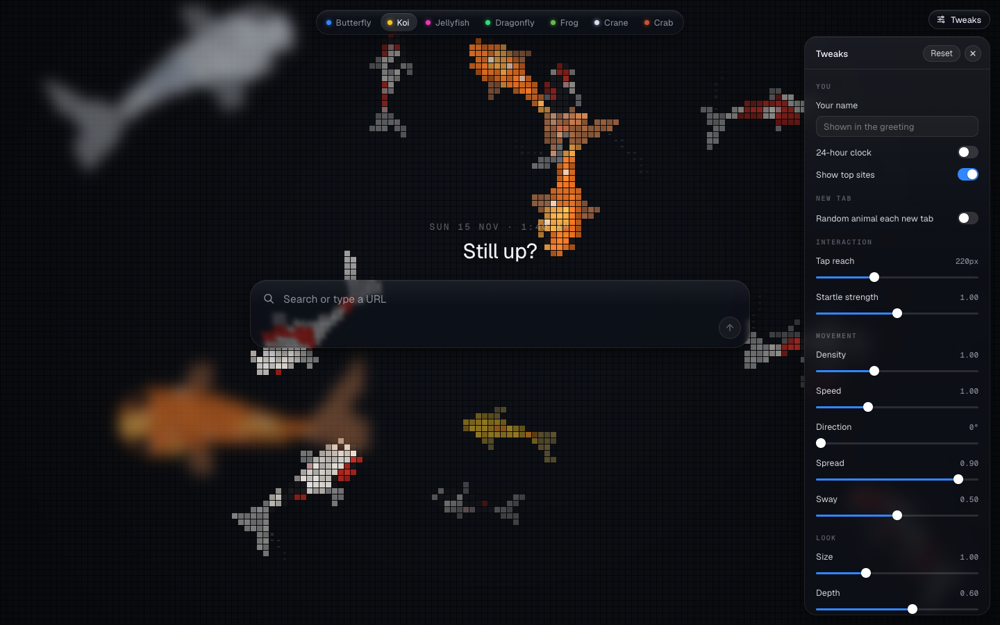

<div align="center">


# ASCII Animals New Tab

**A calm, animated new tab page for Chrome.**
Pixel and ASCII animals drift behind a frosted-glass search bar. Feed the koi, startle the frogs, chase the crabs.

[](https://developer.chrome.com/docs/extensions/develop/migrate/what-is-mv3)
[](https://github.com/Pawan-webdeveloper/Ascii-Animals-extension/releases)
[](LICENSE)
[](newtab.js)
[](#privacy)



</div>

---

## Contents

- [Features](#features)
- [Gallery](#gallery)
- [Installation](#installation)
- [How to use](#how-to-use)
- [Tweaks (settings)](#tweaks-settings)
- [Permissions](#permissions)
- [Privacy](#privacy)
- [Project structure](#project-structure)
- [Development](#development)
- [Troubleshooting](#troubleshooting)
- [Contributing](#contributing)
- [License](#license)

## Features

- 🦋 **Seven animated scenes** — butterflies, koi, jellyfish, dragonflies, frogs, cranes and crabs, each with its own movement and personality.
- 🖱️ **Interactive** — click empty space to feed the koi or startle the others. Some animals shy away from your cursor.
- 🔍 **Glass search bar** — search with your default search engine or type a web address and press Enter.
- ⭐ **Top sites** — your most visited sites appear as shortcuts under the search bar.
- 👋 **Greeting and clock** — a time-of-day greeting with your name, plus date and time (12 h or 24 h).
- 🎛️ **Tweaks panel** — adjust speed, density, direction, size, cell size, ASCII trails, foreground blur and more.
- 🎲 **Random animal mode** — a different animal on every new tab, never the same one twice in a row.
- ☁️ **Synced settings** — your choices follow you across Chrome on every device signed in to the same profile.
- ♿ **Accessible** — keyboard shortcuts for everything, and it slows down when your system's *reduce motion* setting is on.
- 🪶 **Lightweight** — plain HTML, CSS and JavaScript. No frameworks, no build step, no network requests.

## Gallery

| Butterflies | Koi |
| :---: | :---: |
|  |  |
| **Jellyfish** | **Dragonflies** |
|  |  |
| **Frogs** | **Cranes** |
|  |  |
| **Crabs** | **Tweaks panel** |
|  |  |

## Installation

The extension isn't on the Chrome Web Store yet, so you install it in **Developer mode**. It takes about a minute.

### Option 1: Download the ZIP (easiest)

1. Go to the [**latest release**](https://github.com/Pawan-webdeveloper/Ascii-Animals-extension/releases/latest) and download `ascii-animals-extension-vX.Y.Z.zip`.
2. Unzip it into a folder you'll keep (for example `Documents/ascii-animals`).
   > ⚠️ Chrome loads the extension from that folder every time, so don't delete or move it afterwards.
3. Open **`chrome://extensions`** in Chrome.
4. Turn on **Developer mode** (toggle in the top-right corner).
5. Click **Load unpacked** and select the unzipped folder (the one that contains `manifest.json`).
6. Open a new tab. 🎉
   If Chrome asks *"Change back to Google?"* or whether to keep the new tab page, choose **Keep it**.

### Option 2: Clone with Git

```bash
git clone https://github.com/Pawan-webdeveloper/Ascii-Animals-extension.git
```

Then follow steps 3–6 above and select the cloned `Ascii-Animals-extension` folder.

### Other Chromium browsers

It also works in **Microsoft Edge** (`edge://extensions`), **Brave** (`brave://extensions`), **Opera**, **Vivaldi** and **Arc**. The steps are the same: enable Developer mode, then *Load unpacked*.

### Updating

- **ZIP install:** download the new release, replace the files in your folder, then click the ↻ reload icon on the extension's card in `chrome://extensions`.
- **Git install:** run `git pull` in the folder, then click ↻ reload.

### Uninstalling

Open `chrome://extensions` and click **Remove** on *ASCII Animals New Tab*. Your normal new tab page comes back straight away.

## How to use

### Choosing an animal

Click an animal in the bar at the top of the page, or press its number key:

| Key | Animal | What a click does |
| :-: | --- | --- |
| `1` | 🦋 Butterflies | They scatter. They also flutter away from your cursor. |
| `2` | 🐟 Koi | Drops food pellets. Nearby koi rush over, distant ones drift in, and they gather to eat. |
| `3` | 🪼 Jellyfish | They pulse away from the spot. |
| `4` | 🪰 Dragonflies | They dart off. They also avoid your cursor. |
| `5` | 🐸 Frogs | They leap away. |
| `6` | 🕊️ Cranes | They veer off course. |
| `7` | 🦀 Crabs | They bolt away. They also scuttle away from your cursor. |

You can also use the arrow keys, `Home` and `End` while the animal bar has focus.

### Searching

- Press **`/`** to jump into the search box (or just click it).
- Type a search and press **Enter** — it uses your browser's default search engine.
- Type a web address like `github.com` or `localhost:3000` and press **Enter** to go straight there.

> 💡 Chrome always puts the cursor in the address bar when you open a new tab, and extensions aren't allowed to take that focus away. Click the page or press `/` once it has focus.

### Keyboard shortcuts

| Shortcut | Action |
| --- | --- |
| `1` – `7` | Switch animal |
| `/` | Focus the search box |
| `Enter` | Search / open the typed address |
| `Esc` | Close the Tweaks panel |
| `←` `→` `Home` `End` | Move between animals in the picker |

## Tweaks (settings)

Click **Tweaks** in the top-right corner to open the settings panel. Changes apply instantly and are saved with Chrome sync. **Reset** restores the defaults.

| Section | Setting | What it does |
| --- | --- | --- |
| **You** | Your name | Adds your name to the greeting ("Good morning, Sam"). |
| | 24-hour clock | Switches the clock between `1:40 PM` and `13:40`. |
| | Show top sites | Shows or hides your most visited sites under the search bar. |
| **New tab** | Random animal each new tab | Picks a different animal on every new tab, never the same twice in a row. Turn it off to go back to your own pick. |
| **Interaction** | Tap reach | How far a click reaches (and how far koi notice food). |
| | Startle strength | How strongly animals react to clicks. |
| **Movement** | Density | How many animals are on screen. |
| | Speed | How fast they move. |
| | Direction | The main direction of travel (remembered per animal). |
| | Spread | How much individual animals stray from that direction (remembered per animal). |
| | Sway | How much they wobble and drift as they go. |
| **Look** | Size | How big the animals are. |
| | Depth | How much near and far animals differ in size and brightness. |
| | Cell size | The size of each pixel / ASCII cell. |
| | ASCII trails | Leaves fading ASCII characters behind moving animals. |
| | Foreground blur | Adds large, out-of-focus animals in front for a depth-of-field effect. |

## Permissions

The extension asks for as little as possible:

| Permission | Why it's needed |
| --- | --- |
| `chrome_url_overrides.newtab` | Replaces the new tab page with this one. |
| `storage` | Saves your Tweaks settings and syncs them across your devices. |
| `search` | Sends searches to **your** default search engine instead of a hard-coded one. |
| `topSites` | Shows your most visited sites as shortcuts. |
| `favicon` | Shows the little icons next to those shortcuts. |

## Privacy

- **No tracking, no analytics, no ads.**
- **No network requests.** The fonts and all code ship inside the extension.
- Settings are stored with `chrome.storage.sync`, which lives in your own Google account. Nothing is sent anywhere else.
- Your top sites are read locally to draw the shortcuts and never leave your browser.

## Project structure

```
Ascii-Animals-extension/
├── manifest.json       # Extension manifest (Manifest V3)
├── newtab.html         # The new tab page markup
├── newtab.css          # Glass UI, layout and theming
├── newtab.js           # Animals, rendering, interaction, settings
├── icons/              # Toolbar and store icons (16, 32, 48, 128 px)
├── fonts/              # Geist and Geist Mono (SIL Open Font License)
└── docs/screenshots/   # Images used in this README
```

### How it works

- Each animal is drawn procedurally onto a grid of cells on a `<canvas>`. Every cell is either a solid pixel or an ASCII character, which gives the mixed pixel / text look.
- A second canvas holds the blurred foreground animals (the *Foreground blur* option).
- The frosted-glass surfaces use `backdrop-filter` plus an SVG displacement filter to bend what's behind them.
- Animation runs on `requestAnimationFrame` with frame-rate-independent movement, and respects `prefers-reduced-motion`.

## Development

There's no build step. Edit the files and reload:

1. Load the folder with **Load unpacked** (see [Installation](#installation)).
2. Make your changes to `newtab.html`, `newtab.css` or `newtab.js`.
3. Click ↻ **reload** on the extension's card in `chrome://extensions`, then open a new tab.

You can also open `newtab.html` directly in a browser for quick UI work. Chrome-only features (top sites, default search engine, synced settings) are skipped and settings fall back to `localStorage`.

**Adding a new animal:** add an entry to the `ANIMALS` array in `newtab.js` with an `id`, `label`, colour palette, default `direction`/`spread`, a `hint` and its draw and behaviour functions. It shows up in the picker automatically, and number keys are assigned in order.

## Troubleshooting

<details>
<summary><b>My new tab still shows Google / the old page</b></summary>

Make sure the extension is turned on in `chrome://extensions`. Only one extension can control the new tab page at a time, so disable any other new-tab extension. If Chrome showed a "Change back?" prompt, choose **Keep it**.
</details>

<details>
<summary><b>"Manifest file is missing or unreadable"</b></summary>

You selected the wrong folder. Pick the folder that directly contains `manifest.json`, not its parent folder or the ZIP file itself.
</details>

<details>
<summary><b>The extension disappeared after I restarted Chrome / moved the folder</b></summary>

Unpacked extensions load from their folder on disk. If you moved, renamed or deleted it, load it again from its new location.
</details>

<details>
<summary><b>The search box isn't focused when I open a new tab</b></summary>

That's a Chrome restriction: the address bar always gets focus first. Press `/` or click the search box.
</details>

<details>
<summary><b>Animations feel slow or choppy</b></summary>

Open **Tweaks** and lower *Density*, turn off *Foreground blur*, or raise *Cell size*. If your system has *Reduce motion* turned on, animals deliberately move slower.
</details>

## Contributing

Ideas, bug reports and pull requests are welcome!

1. Fork the repository and create a branch: `git checkout -b my-feature`
2. Make your changes and test them with **Load unpacked**.
3. Commit, push and open a pull request describing what you changed (screenshots help!).

Found a bug or have an idea for a new animal? [Open an issue](https://github.com/Pawan-webdeveloper/Ascii-Animals-extension/issues).

## License

The code is released under the [MIT License](LICENSE).

The bundled fonts, [Geist and Geist Mono](https://vercel.com/font), are © Vercel and licensed under the SIL Open Font License 1.1 — see [`fonts/OFL.txt`](fonts/OFL.txt).

---

<div align="center">

If you enjoy it, consider giving the repo a ⭐ — it helps others find it!

</div>
